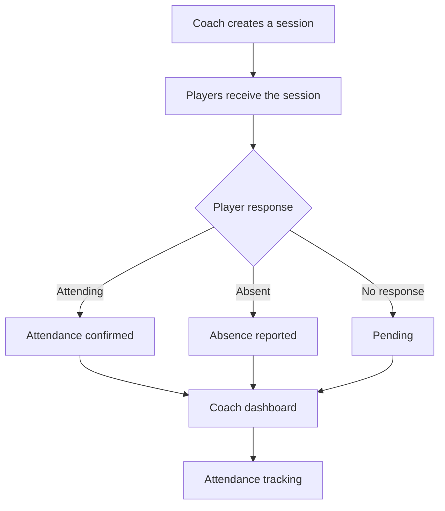

<div align="center">

# ⚽ Pitchcall

### Your team. Your schedule. One place.

Una aplicación web para gestionar entrenamientos, controlar la asistencia de los jugadores y organizar convocatorias de partidos desde una única plataforma.

[](https://react.dev/)
[](https://nodejs.org/)
[](https://expressjs.com/)
[](https://www.mongodb.com/)

</div>

---

## 📖 About the project

Pitchcall is a web application designed to simplify attendance management for amateur football teams.

Instead of relying on WhatsApp messages, manual lists and endless conversations, coaches can organize training sessions, track player availability and manage match call-ups from one centralized platform.

Players can check upcoming activities, confirm their attendance and communicate absences in just a few clicks.

**Less time managing messages. More time focusing on football.**

## ✨ Features

- 🔐 **Authentication & roles** — Secure access for coaches and players.
- 👥 **Team management** — Organize squads and manage player information.
- 📅 **Training sessions** — Create, schedule and manage training sessions.
- ✅ **Attendance tracking** — Players confirm attendance or report absences.
- 📝 **Absence management** — Record explanations for missed sessions.
- 🏆 **Match call-ups** — Organize match selections and check player availability.
- 📊 **Attendance statistics** — Track participation and review attendance history.
- 📱 **Responsive design** — Access the platform from desktop, tablet or mobile.

## ⚽ How it works

### 1. Create a training session

The coach schedules a training session by specifying its date, time and location.

### 2. Players confirm their availability

Each player accesses the session and selects whether they will attend. Players who cannot participate can report their absence and provide a reason.

### 3. The coach checks attendance

All responses are displayed in a centralized dashboard, making it easy to identify available players and those who have not answered.

### 4. Manage match call-ups

The coach creates match call-ups and selects the players who will be invited to participate.

### 5. Track team participation

Attendance records are stored to build a history of participation and generate useful statistics.




## 🛠️ Tech Stack

| Technology | Purpose |
|---|---|
| React | User interface |
| JavaScript | Frontend logic |
| Tailwind CSS | Styling and responsive design |
| Node.js | Backend runtime |
| Express.js | REST API |
| MongoDB | NoSQL database |
| JWT | Authentication |
| Git & GitHub | Version control |

## 🏗️ Architecture

```text
pitchcall/
│
├── frontend/          # React application
│   ├── src/
│   │   ├── components/
│   │   ├── pages/
│   │   ├── services/
│   │   └── App.jsx
│   └── package.json
│
├── backend/           # Node.js and Express API
│   ├── src/
│   │   ├── controllers/
│   │   ├── models/
│   │   ├── routes/
│   │   ├── middleware/
│   │   └── server.js
│   └── package.json
│
├── docs/
│   └── images/        # Application screenshots
│
├── .gitignore
└── README.md
```

*Proposed project structure; actual folders may vary depending on implementation.*

## 🚀 Getting Started

### Prerequisites

- [Node.js](https://nodejs.org/)
- npm
- [MongoDB](https://www.mongodb.com/)

### Installation

**1. Clone the repository**

```bash
git clone https://github.com/YOUR_USERNAME/pitchcall.git
cd pitchcall
```

**2. Install backend dependencies**

```bash
cd backend
npm install
```

**3. Install frontend dependencies**

```bash
cd ../frontend
npm install
```

**4. Configure environment variables**

Create a `.env` file in the backend directory:

```env
PORT=5000
MONGODB_URI=your_mongodb_connection_string
JWT_SECRET=your_secure_secret
CLIENT_URL=http://localhost:5173
```

Configure the frontend API URL according to your development environment.

**5. Start the application**

Run the backend from the `backend` directory:

```bash
npm run dev
```

In a separate terminal, start the frontend:

```bash
cd frontend
npm run dev
```

Open the local URL displayed by the frontend development server.

*Note: The commands and environment variables must match the actual project configuration.*

## 🗺️ Roadmap

- [ ] Authentication and role management.
- [ ] Team and player management.
- [ ] Training session scheduling.
- [ ] Attendance confirmation and absence reporting.
- [ ] Coach dashboard.
- [ ] Match call-ups.
- [ ] Attendance history and statistics.
- [ ] Responsive mobile interface.
- [ ] Notifications and reminders.
- [ ] Automated testing and production deployment.

## 🔒 Security & Privacy

The application is designed with user privacy and access control in mind.

- Passwords stored using secure hashing.
- Protected routes and role-based permissions.
- Server-side validation.
- Restricted access to team information.
- Environment variables for sensitive configuration.

## 👨‍💻 Author

**Gerard Marín**

Full Stack Development student passionate about building practical applications and exploring new technologies.

This project aims to solve a real problem in amateur football through a simple, accessible and centralized attendance management system.

---

<div align="center">

**⚽ Built for teams. Designed for football.**

</div>